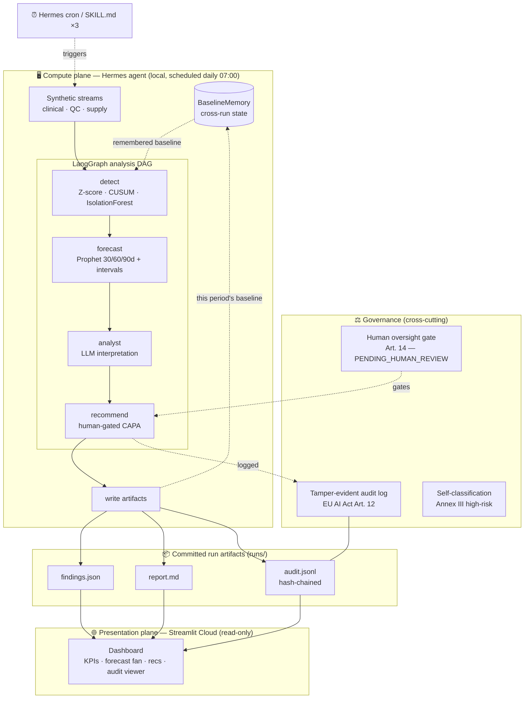

# OrgPulse AI — Architecture

OrgPulse is a **split-plane** system. A **compute plane** (the Hermes-scheduled agent)
does all the heavy work locally and commits small, tamper-evident **run artifacts**; a
**presentation plane** (the Streamlit dashboard) only *reads* those artifacts. The two
planes share nothing but the `runs/` directory — which is why the dashboard deploys to
Streamlit Cloud with three lightweight dependencies and never imports Prophet or LangGraph.

## The planes

| Plane | Runs where | Deps | Responsibility |
|-------|-----------|------|----------------|
| **Compute** | Local / self-hosted, Hermes-scheduled | full stack (numpy, scikit-learn, Prophet, LangGraph, anthropic) | Generate → detect → forecast → reason → recommend → write artifacts; remember baselines |
| **Presentation** | Streamlit Cloud | `streamlit`, `pandas`, `plotly` | Read `runs/latest` + history; render; re-verify the audit chain |

Keeping the planes apart is what makes the public demo both **cheap to host** and **always
alive**: the dashboard has no model to run and no key to hold — it renders committed results.

## The analysis DAG (LangGraph)

`detect → forecast → analyst → recommend`, a typed `StateGraph`:

1. **detect** — Z-score + window-calibrated CUSUM (+ IsolationForest) per KPI against the
   *remembered* baseline. Corrupt/insufficient data surfaces as `DATA_QUALITY`, which
   **dominates** overall severity — it never silently passes as "all clear".
2. **forecast** — deterministic Prophet on the hero KPI (`daily_enrollment`): 30/60/90-day
   point forecast with a calibrated 90% interval. Backtested honestly (it does *not* beat naïve).
3. **analyst** — an LLM turns the numbers into a GxP-framed interpretation. Offline
   deterministic stub by default (keyless); Claude Sonnet when `ANTHROPIC_API_KEY` is set.
4. **recommend** — a human-gated CAPA recommendation per anomaly, each
   `PENDING_HUMAN_REVIEW` with an EU AI Act Art. 14 disclaimer. Data-quality findings get a
   distinct "do not open a CAPA — fix the data" recommendation instead.

## Cross-run memory (the "autonomous" part)

Each tick detects the **recent period** (30 days) against the **established baseline**
(a 120-day trailing window) remembered from the previous tick, then writes the new baseline
back. The baseline window is deliberately longer than the detection window so CUSUM's
false-alarm calibration (which needs ≥60 samples) always holds — otherwise every
post-bootstrap tick would degrade to `DATA_QUALITY`.

## Governance is not a feature — it's a cross-cut

- **Art. 12 logging** → every run and recommendation is appended to a **hash-chained**
  `audit.jsonl`; altering any past entry breaks the chain and `verify()` returns `False`.
  The dashboard re-verifies the chain live (with a standalone verifier proven equivalent to
  the compute-plane implementation in tests).
- **Art. 14 human oversight** → the system is *architecturally* prohibited from acting; the
  strongest output it can emit is a recommendation awaiting a qualified human.
- **Annex III self-classification** → machine-readable (`governance/classification.py`) and
  rendered to `docs/EU_AI_ACT_SELF_CLASSIFICATION.md`.

See [CASE_STUDY.md](CASE_STUDY.md) for the reasoning behind these choices and the honest results.
