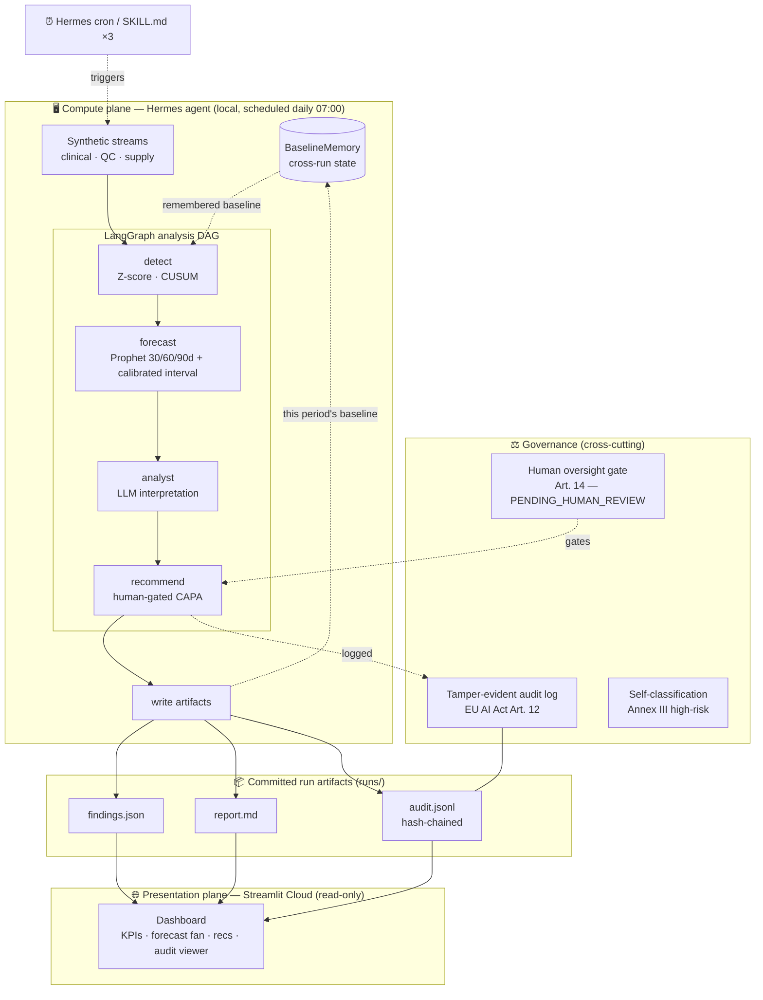

# OrgPulse AI — Architecture

OrgPulse is a **split-plane** system. A **compute plane** (the Hermes-scheduled agent)
does all the heavy work locally and commits small, tamper-evident **run artifacts**; a
**presentation plane** (the Streamlit dashboard) only *reads* those artifacts. The two
planes share nothing but the `runs/` directory — which is why the dashboard deploys to
Streamlit Cloud with three lightweight dependencies and never imports Prophet or LangGraph.

## The planes

| Plane | Runs where | Deps | Responsibility |
|-------|-----------|------|----------------|
| **Compute** | Local / self-hosted, Hermes-scheduled | full stack (numpy, scikit-learn, Prophet, LangGraph, anthropic) | Generate → detect → forecast → reason → recommend → write artifacts; remember baselines |
| **Presentation** | Streamlit Cloud | `streamlit`, `pandas`, `plotly` | Read `runs/latest` + history; render; re-verify the audit chain |

Keeping the planes apart is what makes the public demo both **cheap to host** and **always
alive**: the dashboard has no model to run and no key to hold — it renders committed results.

## The analysis DAG (LangGraph)

`detect → forecast → analyst → recommend`, a typed `StateGraph`:

1. **detect** — Z-score + window-calibrated CUSUM per KPI against the *remembered* baseline.
   Corrupt/insufficient data surfaces as `DATA_QUALITY`, which **dominates** overall
   severity — it never silently passes as "all clear". (Isolation Forest is built but not
   wired — see [Detector status](#detector-status).)
2. **forecast** — deterministic Prophet on the hero KPI (`daily_enrollment`): 30/60/90-day
   point forecast with an **in-sample-calibrated** 90% interval (the calibration factor is
   applied to the published bounds, not just diagnosed). Backtested honestly (it does *not*
   beat naïve; out-of-sample interval coverage is not claimed). When the domain implements
   `lineage_extract`, the forecast also publishes a data-lineage **confidence** score, computed
   from the hero's contributing records and applied as a second, separately-reported widening
   factor on top of the statistical calibration (see [CASE_STUDY](CASE_STUDY.md#genealogy-aware-forecast-trust-honest-about-what-it-proves)).
3. **analyst** — an LLM turns the numbers into a GxP-framed interpretation. Offline
   deterministic stub by default (keyless); Claude Sonnet when `ANTHROPIC_API_KEY` is set
   **and** `--online` is passed (the CLI defaults to `--offline`).
4. **recommend** — a human-gated CAPA recommendation per anomaly, each
   `PENDING_HUMAN_REVIEW` with an EU AI Act Art. 14 disclaimer. Data-quality findings get a
   distinct "do not open a CAPA — fix the data" recommendation instead.

## Cross-run memory (the "autonomous" part)

Each tick detects the **recent period** (30 days) against the **established baseline**
(a 120-day trailing window) remembered from the previous tick, then writes the new baseline
back. The baseline window is deliberately longer than the detection window so CUSUM's
false-alarm calibration (which needs ≥60 samples) always holds — otherwise every
post-bootstrap tick would degrade to `DATA_QUALITY`. `run_tick` validates these
preconditions at entry (`baseline_days ≥ 120` — the shared minimum-history contract both the
run pipeline and the tick enforce — and `base_days ≥ max(baseline_days, days_per_period)`) and
never persists a baseline below the 60-sample floor.

**What "remembered" means (and doesn't).** The agent remembers baseline **statistics**
(mean/std/n per KPI), not raw data. In this synthetic prototype the generators produce a
**fresh realization at the requested horizon on each tick** — a longer horizon is a new draw
from the same data-generating process, not an append to the previous tick's exact series. So
a tick detects a new realization's recent period against summary statistics carried over from
the previous realization. Detection stays valid because both realizations share the same
underlying process (a structural break lives in the process and appears in every realization
at the same point), but this is deliberately **not** an append-only "one evolving world". A
production deployment would persist and append real observed data (or use counter-based,
date-keyed RNG) so history is byte-stable across horizons; that is out of scope here.

### Detector status

| Detector | Status |
|----------|--------|
| Baseline (mean/std/n) | Live |
| Z-score | Live — wired into the detection node |
| Window-calibrated CUSUM | Live — wired into the detection node |
| Isolation Forest (`detect/isolation.py`) | **Built & unit-tested, NOT wired** into the live path; no multivariate orchestration yet |

The README and diagram reflect the *live* stack (Z-score + CUSUM). Isolation Forest is
retained as a tested component pending a multivariate integration; it does not run in the
current pipeline.

## Domain configuration (the engine is domain-agnostic)

Everything above — detection, forecasting, the LangGraph DAG, the autonomous tick, the audit
trail, the dashboard loader — is a **domain-agnostic engine**. Everything that differs between one
regulated domain and another lives behind a single `Domain` value (`orgpulse/core/domain.py`):

| The `Domain` carries | Pharma (this repo) |
|----------------------|--------------------|
| `generate(start, days, seed)` → streams | clinical, QC, supply generators |
| `extract(streams, kpi)` → 1-D series | per-KPI extraction (validated raw rows before aggregation) |
| `kpi_specs` — `KpiSpec(name, domain_bounds, detection_mode, is_hero, thresholds)` | 4 KPIs, all `TIMESERIES`, hero = `daily_enrollment` |
| `hero_frame(streams)` → dated frame | the daily enrollment series for Prophet |
| `lineage_extract(streams)` → (dates, source tiers) *(optional)* | per-clinical-record provenance tagging (`None` if a domain makes no genealogy-awareness claim) |
| `analyst_system` / `recommend_system` | online (Claude) GxP / ICH-E6(R3) framing |
| `offline_framing` / `offline_recommend` | keyless-stub GxP / CAPA language |
| `lineage_caveat(kpi)` → str | low-lineage-trust recommendation text (GxP-framed) |
| `compliance` | EU AI Act context |

**This is a code interface, not a "swap a YAML file" platform** — generators and extractors are
functions, and detection modes are engine strategies: **`TIMESERIES`** (z-score + calibrated
CUSUM against a baseline), **`THRESHOLD`** (hard min/max rules on the latest value — e.g. a capital
floor), and **`DATEMATH`** (deadline days-until arithmetic) are all wired and mutation-tested. A
KPI declares its mode (and, for THRESHOLD, its warn/critical thresholds) in its `KpiSpec`;
non-timeseries modes need only the latest value, not a full baseline.

**Proven, not asserted:** `tests/core/test_second_domain.py` builds minimal *non-pharma* domains
(a timeseries `DEMO`, a mixed-mode `MULTIMODE`, and a pure rule-mode `RULEONLY`) and runs the full
stack on them — `run_tick`, the public `run_pipeline`, the LangGraph pipeline, the hero forecast,
`verify_run`, and the offline framing — with **no engine changes**. Each test is
**mutation-constrained**: reverting any single fix (the detect/forecast parity guard, the hero-frame
date validation, timezone normalization and hero-`y` float coercion (a numeric-string/object y is
normalized back into the frame Prophet consumes), and type/fail-closed guarding (every UNTRUSTED
domain callable — `extract`, `hero_frame` — is wrapped in a broad `except Exception` so ANY failure,
not just shape/conversion errors, yields DATA_QUALITY / no forecast, never a crash; only
`BaseException`/`KeyboardInterrupt` escapes), the generic `streams` state, the domain-agnostic
verifier (which also rejects an alerting artifact whose governed-recommendation stage is empty or
blank, OR that is internally CONTRADICTORY — overall_severity disagreeing with the KPI findings,
`alert` disagreeing with policy, a recommendation for an unassessed KPI, or forecast bounds violating
lower ≤ yhat ≤ upper), the OverflowError-safe numeric gates (the rule detectors' `_latest_finite`,
the shared `kpi_series_reason`, the timeseries `ensure_1d_finite`, the forecast y-coercion, the
scalar `is_finite_scalar` family, and `BaselineMemory` loading all fail a huge int to
DATA_QUALITY / False / a clear operator error), the guarded analyst + recommendation callables (a
raising or malformed `llm.analyze`/`offline_recommend`/`dq_recommendation` never crashes and never
empties the governed stage — a deterministic safe fallback is used), the atomic tick write (staged
in a private dir and swapped in, so neither a malformed `generate()` NOR a mid-write filesystem
failure leaves a partial run directory), the string-typed `Domain` framing fields and non-empty
KPI-name validation, the domain-hero references, the `Domain` config validation — including THRESHOLD/DATEMATH
threshold finiteness, strict band reachability (equal/inverted cutoffs rejected so no severity is
unreachable) and unknown-key rejection, the per-mode detection dispatch, the rule detectors'
standalone fail-safe on malformed/non-finite input — empty/ragged/2-D/non-numeric/0-D/NaN/inf all
return the shared `score=None, flagged=True` DATA_QUALITY result — or the tick's timeseries-only
baseline contract) makes a test fail — so the suite
genuinely pins the invariants, it isn't a vacuous pass. Every node/loop takes
`domain: Domain = PHARMA`, so pharma behavior is the default and byte-for-byte unchanged by this
seam (golden-master gated).

**Honest residuals (a new domain refines these; they are *framing/config*, not engine code — a
second domain still produces correct, verifiable, non-pharma output despite them):**
- The recommendation field/label is still named `capa_frame`/"CAPA Frame:" (pharma terminology; the
  *value* is domain-supplied).
- `governance/classification.py` renders a pharma EU-AI-Act document rather than reading
  `domain.compliance`; a second domain supplies its own compliance content.
- `Domain`'s `compliance` field is a plain (mutable) dict and the value isn't hashable — it's a
  configuration record, not a hash key, so this is acceptable but noted.
- The tick's `input_data_hash` hashes `streams.values()` in insertion order, so a `Domain.generate`
  **must return its streams in a stable order** (Python dicts preserve construction order; every
  generator does). This is a domain contract, stated on `Domain.generate`.

## Governance is not a feature — it's a cross-cut

- **Art. 12 logging** → every run and recommendation is appended to a **hash-chained**
  `audit.jsonl`. The run entry records the input **lineage** — the generation `seed` and
  parameters, an `input_data_hash` of the actual input frames, and (for a remembered-baseline
  tick) a `baseline_input_hash` of the baseline that drove detection — plus output-integrity
  hashes `findings_hash` and `report_hash`, and the model+version. The dashboard's `verify_run`
  checks the chain; that the displayed `findings.json` AND `report.md` still hash to what the
  run entry attests to (so editing either is caught); and that the number of logged
  recommendation entries matches the count in `findings.json` (so deleting trailing records —
  which a forward hash chain can't detect on its own — is caught too). Both verifiers (dashboard
  and compute-plane) fail closed on missing/empty/malformed logs; a proven-equivalence test
  guards against drift between the two implementations. An **offline** decision (the deterministic
  default) can be exactly **regenerated** from the recorded lineage and its outputs checked against
  the logged hashes; an **online** (Claude) run is fully traceable but its LLM output is stochastic
  and not bit-reproducible (no model snapshot / decoding params are captured).

  **Threat model (stated honestly):** an *unkeyed* hash chain stored in the same writable
  file detects **accidental corruption and naïve tampering** (editing a past entry, or the
  findings, breaks verification). It does **not** stop an adversary with write access who
  rewrites the whole file and recomputes the chain forward using the public algorithm — that
  requires a signature under a key the artifact writer doesn't hold, or anchoring the terminal
  hash in a separate trusted store. Keyed signing is deliberately out of scope for this
  keyless-by-default prototype and is noted as future work.
- **Art. 14 human oversight** → the system is *architecturally* prohibited from acting; the
  strongest output it can emit is a recommendation awaiting a qualified human.
- **Annex III self-classification** → machine-readable (`governance/classification.py`) and
  rendered to `docs/EU_AI_ACT_SELF_CLASSIFICATION.md`.

See [CASE_STUDY.md](CASE_STUDY.md) for the reasoning behind these choices and the honest results.
